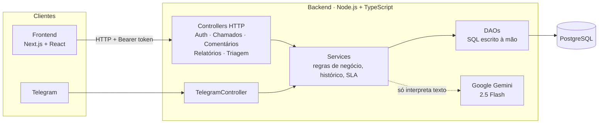

<div align="center">


### Sistema de atendimento de TI com triagem por Inteligência Artificial

Abertura, acompanhamento e resolução de chamados com regras de negócio de verdade,
prazos de SLA, histórico auditável e um assistente que atende também pelo Telegram.


</div>

---

## Sumário

- [Visão geral](#visão-geral)
- [Funcionalidades](#funcionalidades)
- [Arquitetura](#arquitetura)
- [Decisões técnicas que fazem diferença](#decisões-técnicas-que-fazem-diferença)
- [Regras de negócio](#regras-de-negócio)
- [Tecnologias](#tecnologias)
- [Como executar](#como-executar)
- [API REST](#api-rest)
- [Estrutura do repositório](#estrutura-do-repositório)
- [Limitações conhecidas e próximos passos](#limitações-conhecidas-e-próximos-passos)
- [Equipe](#equipe)

---

## Visão geral

O **SupportBox** é um sistema interno de *help desk* para equipes de TI. O solicitante descreve o
problema, a IA sugere os primeiros passos e a prioridade, e o chamado entra na fila com protocolo,
prazo de resolução e histórico completo. O agente assume, conversa, reclassifica e conclui, pelo
navegador ou por mensagem no Telegram, em linguagem natural.

O projeto é dividido em duas aplicações independentes:

| Projeto | Papel | Porta |
|---|---|---|
| [`supportbox-backend`](supportbox-backend/) | API REST, regras de negócio, persistência, IA e bot do Telegram | `4000` |
| [`supportbox-frontend`](supportbox-frontend/) | Interface web (portal do solicitante e painel do agente) | `3000` |

---

## Funcionalidades

### Para o solicitante
- **Abertura de chamado guiada**, com validação de título, descrição, categoria e tipo.
- **Triagem por IA** com o botão *Analisar com IA*: o Gemini sugere passos de autoatendimento e a
  prioridade, que já é gravada no chamado ao enviar.
- **Acompanhamento** dos próprios chamados, com status, prazo e histórico de conversa.
- **Reabertura** de um chamado concluído em até 7 dias corridos.

### Para o agente
- **Fila de chamados** com busca por palavra e abas por situação (Aberto, Em Andamento, Concluído).
- **Ações completas**: assumir, concluir, reatribuir, alterar prioridade e comentar.
- **Alerta de SLA**: cada chamado mostra o tempo restante e recebe a etiqueta vermelha
  **Atrasado** quando estoura o prazo.
- **Painel de Dados**: total de chamados, em andamento, concluídos, atrasados e distribuição por
  situação e por prioridade.
- **Relatórios por período**: chamados criados e concluídos, tempo médio de atendimento, volume por
  atendente e por categoria.
- **Bot do Telegram**: o agente comenta e conclui chamados escrevendo frases como
  *"pode fechar o CH-2026-008, resolvido"*.

### Para a organização
- **Autenticação real** com senha protegida (scrypt) e token de sessão assinado (HMAC-SHA256).
- **Histórico automático e imutável**: toda mudança de status, prioridade ou responsável gera um
  registro do autor *Sistema*, dizendo quem fez e o que mudou.
- **Protocolo legível e sequencial** no formato `CH-AAAA-NNN`.
- **Controle de acesso por papel** aplicado no backend, nunca só escondendo botões na tela.

---

## Arquitetura

O sistema segue o padrão **MVC em camadas**. No backend, o *Model* é dividido em **Service**
(regras de negócio) e **DAO** (persistência), o que mantém cada parte com uma responsabilidade só.



| Camada | Responsabilidade | Não sabe nada de |
|---|---|---|
| **View** (frontend) | Exibir dados e capturar ações | Regras de negócio, banco |
| **Controller** | Receber a requisição, conferir o formato, responder | SQL, regras |
| **Service** | Decidir se a operação respeita as regras do sistema | HTTP, SQL |
| **DAO** | Ler e gravar no banco | Regras de negócio |

O Telegram entrou como **mais uma porta de entrada**: o `TelegramController` chama os mesmos
Services que os Controllers HTTP. Nenhuma regra foi reescrita, e fechar um chamado pelo bot gera o
mesmo histórico que fechar pelo site.

---

## Decisões técnicas que fazem diferença

**Camadas que provam seu valor.** O projeto trocou de banco duas vezes: de dados em memória para um
banco hospedado e depois para PostgreSQL nativo. Na segunda troca, **nenhuma linha fora de
`src/dao/` e `src/db.ts` mudou**. A troca da identificação provisória pelo login real seguiu a mesma
lógica: só `utils/ator.ts` precisou saber de onde vem a identidade.

**IA que ajuda e nunca atrapalha.**
- As respostas do Gemini são pedidas em **formato estruturado** e conferidas com **Zod** antes de
  serem usadas.
- Se a IA falhar ou estiver sobrecarregada, o sistema degrada com elegância: o solicitante vê um
  aviso e **continua podendo abrir o chamado** normalmente.
- A IA **só interpreta texto**. Quem executa as ações são os Services, com todas as regras.
- O prompt do assistente do Telegram trata a mensagem do usuário como dado, **não como instrução**,
  como proteção contra *prompt injection*.

**Segurança pensada desde o início.**
- Senhas guardadas apenas como resumo **scrypt** com *salt* (módulo `crypto` nativo do Node, sem
  dependência extra). Se o banco vazar, as senhas não vazam.
- Token de sessão assinado com **HMAC-SHA256**, comparado com `timingSafeEqual` e válido por 8 horas.
  A conferência não precisa consultar o banco a cada requisição.
- Mensagem única para e-mail ou senha errados (*"E-mail ou senha inválidos."*), para não ajudar quem
  tenta adivinhar contas.
- Qualquer `401` no frontend apaga a sessão e volta ao login com aviso de sessão expirada.
- Segredos só no `.env`, fora do Git. O servidor **não sobe** sem `DATABASE_URL`, `GEMINI_API_KEY`
  e `SESSAO_SEGREDO`, e diz exatamente o que falta.

**Defesa em profundidade no banco.** As restrições `CHECK`, `UNIQUE` e `REFERENCES` repetem no
PostgreSQL validações que o Service já faz. Se um bug escapar do código, o banco ainda recusa o
dado inválido.

**Sem framework HTTP.** O servidor usa o módulo `http` nativo do Node, com um roteador próprio de
poucas linhas. Cada passo de uma requisição é explícito e fácil de explicar.

**Portável entre ambientes.** O mesmo código roda em PostgreSQL local ou no Supabase; muda só a
`DATABASE_URL`. O SSL é ligado automaticamente quando o endereço não é de rede local.

**Cálculo de prazo correto no fuso local.** O SLA soma dias úteis usando a hora local, evitando o
erro clássico em que uma sexta às 22h em Brasília vira sábado em UTC.

**Código documentado.** Cada arquivo abre com um bloco explicando seu papel, e as funções trazem o
*porquê* das decisões, não só o *o quê*.

---

## Regras de negócio

As regras são aplicadas na camada **Service** do backend, a única fonte confiável. O documento
completo está em [`REGRAS_DE_NEGOCIO.md`](supportbox-backend/REGRAS_DE_NEGOCIO.md).

| # | Regra | Resumo |
|---|---|---|
| 1 | Ciclo de vida | `Aberto → Em Andamento → Concluído`, sem pular etapas |
| 2 | Responsável único | Só agentes assumem; só o agente atribuído conclui |
| 3 | Visibilidade por papel | Solicitante vê apenas os próprios chamados; agente vê todos |
| 4 | Validação na abertura | Título ≥ 5 caracteres, descrição ≥ 20, categoria e tipo válidos; protocolo `CH-AAAA-NNN` |
| 5 | Histórico imutável | Comentários não são editados nem apagados; mudanças geram registro do *Sistema* |
| 6 | SLA por prioridade | Alta: 1 dia útil · Média: 3 dias úteis · Baixa: 5 dias úteis |
| 7 | Reabertura controlada | O solicitante pode reabrir em até 7 dias corridos após a conclusão |

---

## Tecnologias

| Backend | Frontend | Infraestrutura |
|---|---|---|
| Node.js 18+ (`http` nativo) | Next.js 15 (App Router) | PostgreSQL 13+ |
| TypeScript 5 | React 19 | Supabase (opcional) |
| `pg` (SQL escrito à mão) | TypeScript 5 | Google AI Studio (Gemini) |
| `@google/genai` (Gemini 2.5 Flash) | Tailwind CSS 3 (paleta semântica) | Telegram Bot API |
| Zod (validação das respostas da IA) | lucide-react (ícones) | |
| `tsx` (desenvolvimento com *reload*) | | |

---

## Como executar

### Pré-requisitos

- **Node.js 18** ou mais novo
- **PostgreSQL 13** ou mais novo (local ou Supabase)
- Uma chave gratuita do **Gemini**, em [aistudio.google.com/apikey](https://aistudio.google.com/apikey)
- *(Opcional)* um token de bot do **Telegram**

### 1. Banco de dados

Crie o banco e rode o script de estrutura uma única vez:

```bash
createdb -U postgres supportbox
psql -U postgres -d supportbox -f supportbox-backend/banco/schema.sql
```

> Banco criado antes de novembro? Rode também `banco/migracao-novembro.sql`, que adiciona a tabela
> `usuarios` e a coluna `prazo_em`. O guia completo (rede local, firewall, Supabase e solução de
> problemas) está em [`banco/COMO_RODAR.md`](supportbox-backend/banco/COMO_RODAR.md).

### 2. Backend

```bash
cd supportbox-backend
npm install
cp .env.example .env      # preencha as variáveis abaixo
npm run dev               # http://localhost:4000
```

| Variável | Obrigatória | Descrição |
|---|:---:|---|
| `DATABASE_URL` | ✅ | Endereço do PostgreSQL |
| `GEMINI_API_KEY` | ✅ | Chave da API do Gemini |
| `SESSAO_SEGREDO` | ✅ | Frase longa e aleatória usada para assinar os tokens |
| `PORT` | | Porta da API (padrão `4000`) |
| `ORIGEM_FRONTEND` | | Origem liberada no CORS (padrão `http://localhost:3000`) |
| `TELEGRAM_BOT_TOKEN` | | Liga o bot do Telegram |
| `TELEGRAM_AGENTES` | | Lista `idTelegram:email` dos agentes reconhecidos pelo bot |

O [`.env.example`](supportbox-backend/.env.example) explica cada variável em detalhe.

### 3. Usuários

Não há tela de cadastro: os usuários são criados pelo terminal, e a senha é gravada apenas como
resumo.

```bash
npm run criar-usuario -- <email> <senha> <papel> "<Nome Completo>"

# exemplos
npm run criar-usuario -- ana.agente@empresa.com senhaForte123 agente "Ana Souza"
npm run criar-usuario -- joao@empresa.com outraSenha456 solicitante "João Lima"
```

### 4. Frontend

Em outro terminal:

```bash
cd supportbox-frontend
npm install
npm run dev               # http://localhost:3000
```

Por padrão o frontend procura a API em `http://localhost:4000`. Para apontar para outro endereço,
crie um arquivo `.env.local`:

```env
NEXT_PUBLIC_API_URL=http://localhost:4000
```

Acesse **http://localhost:3000**, entre com um dos usuários criados e pronto.

> **Dica para ver o fluxo completo:** abra um chamado como solicitante em uma janela e, em uma janela
> anônima, entre como agente para assumir, comentar e concluir o mesmo chamado.

### Build de produção

```bash
# backend
npm run build && npm start

# frontend
npm run build && npm start
```

---

## API REST

Todas as rotas usam o prefixo `/api`. Exceto o login, todas exigem o cabeçalho
`Authorization: Bearer <token>`.

| Método | Rota | Descrição | Acesso |
|---|---|---|---|
| `POST` | `/api/auth/login` | Entra com e-mail e senha e recebe o token | Público |
| `GET` | `/api/auth/me` | Confere a sessão e devolve o usuário | Autenticado |
| `POST` | `/api/auth/logout` | Encerra a sessão | Autenticado |
| `POST` | `/api/triagem` | Analisa um rascunho com IA (passos e prioridade) | Autenticado |
| `POST` | `/api/chamados` | Abre um chamado | Autenticado |
| `GET` | `/api/chamados` | Lista chamados (filtrados pelo papel) | Autenticado |
| `GET` | `/api/chamados/:id` | Detalha um chamado | Dono ou agente |
| `POST` | `/api/chamados/:id/assumir` | Assume o chamado | Agente |
| `POST` | `/api/chamados/:id/concluir` | Conclui o chamado | Agente atribuído |
| `POST` | `/api/chamados/:id/reabrir` | Reabre em até 7 dias | Solicitante dono |
| `PATCH` | `/api/chamados/:id/atribuir` | Reatribui a outro agente | Agente |
| `PATCH` | `/api/chamados/:id/prioridade` | Altera a prioridade e recalcula o prazo | Agente |
| `GET` | `/api/chamados/:id/comentarios` | Lista o histórico | Dono ou agente |
| `POST` | `/api/chamados/:id/comentarios` | Adiciona um comentário | Dono ou agente atribuído |
| `GET` | `/api/relatorios?de=AAAA-MM-DD&ate=AAAA-MM-DD` | Relatório de atendimentos por período | Agente |

<details>
<summary><b>Exemplo: login e listagem</b></summary>

```bash
curl -X POST http://localhost:4000/api/auth/login \
  -H "Content-Type: application/json" \
  -d '{"email":"ana.agente@empresa.com","senha":"senhaForte123"}'
```

```json
{
  "token": "eyJpZCI6...",
  "usuario": { "email": "ana.agente@empresa.com", "nome": "Ana Souza", "papel": "agente" }
}
```

```bash
curl http://localhost:4000/api/chamados -H "Authorization: Bearer <token>"
```

Sem token, com token alterado ou vencido, a API responde
`401 { "erro": "Sessão inválida ou expirada." }`.

</details>

<details>
<summary><b>Exemplo: conversa com o bot do Telegram</b></summary>

```
Agente:  comenta no CH-2026-008 que troquei o cabo de rede
Bot:     Comentario adicionado no CH-2026-008.

Agente:  pode fechar o CH-2026-008, resolvido
Bot:     Pronto, CH-2026-008 concluido.
```

O bot só reconhece agentes listados em `TELEGRAM_AGENTES`, e todas as regras do site continuam
valendo: por exemplo, só o agente atribuído consegue concluir.

</details>

---

## Estrutura do repositório

```
.
├── supportbox-backend/
│   ├── banco/
│   │   ├── schema.sql                 estrutura do banco (idempotente)
│   │   ├── migracao-novembro.sql      usuários + prazo de SLA
│   │   └── COMO_RODAR.md              guia de instalação do banco
│   ├── src/
│   │   ├── controllers/               HTTP e Telegram → Services
│   │   ├── services/                  regras de negócio, IA, SLA
│   │   ├── dao/                       persistência em SQL
│   │   ├── routes/                    tabela de rotas
│   │   ├── utils/                     token, senha, corpo JSON, respostas
│   │   ├── scripts/criarUsuario.ts    cadastro de usuários pelo terminal
│   │   ├── dominio.ts                 tipos do domínio
│   │   ├── erros.ts                   erros de domínio → códigos HTTP
│   │   ├── ia.ts                      conexão com o Gemini
│   │   ├── telegram.ts                cliente da API de bots
│   │   ├── app.ts                     roteador sobre o http nativo
│   │   └── server.ts                  ponto de entrada
│   ├── REGRAS_DE_NEGOCIO.md
│   └── PASSO_A_PASSO_IA.md            como o agente de IA foi construído
│
└── supportbox-frontend/
    └── src/
        ├── app/                       rotas: /login, /solicitante, /agente, /agente/dados, /agente/relatorios
        ├── views/                     componentes visuais (agente, solicitante, compartilhado, auth)
        └── lib/                       cliente da API, sessão e mapeamento de dados
```

A separação entre `src/app` (rotas exigidas pelo Next.js, arquivos curtos) e `src/views` (a
interface de fato) deixa os componentes reaproveitáveis e independentes da origem dos dados.

---

## Limitações conhecidas e próximos passos

Itens deixados de fora de propósito para manter o escopo enxuto, e que formam o caminho natural de
evolução:

- [ ] **SLA completo**: prazo de primeira resposta, pausa do cronômetro enquanto se aguarda o
  solicitante e calendário de feriados.
- [ ] **Sessão revogável**: hoje o *logout* apaga o token no navegador; uma cópia continuaria válida
  até vencer (8 horas).
- [ ] **Proteção contra força bruta** e recuperação de senha por e-mail.
- [ ] Validar, na reatribuição, se o novo responsável é um agente cadastrado.
- [ ] Testes automatizados e publicação em ambiente de produção.
- [ ] Anexos, notificações por e-mail e pesquisa de satisfação.

---

## Equipe

Projeto acadêmico desenvolvido no 8º semestre.

| Integrante | Área |
|---|---|
| **Ciro** | Backend: banco de dados, usuários, senhas e cálculo de prazos · integração |
| **Gabriel** | Backend: autenticação, sessão, histórico automático e SLA na camada Service |
| **Isaac** | Frontend: login, sessão, fila de chamados e alerta de prazo |
| **Renata** | Frontend: guia visual, histórico, portal do solicitante, Painel de Dados e Relatórios |
